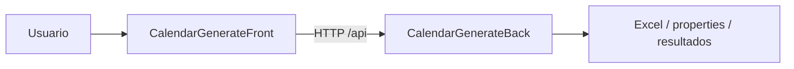
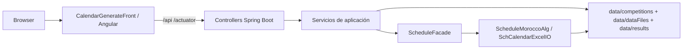
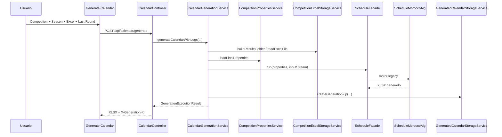
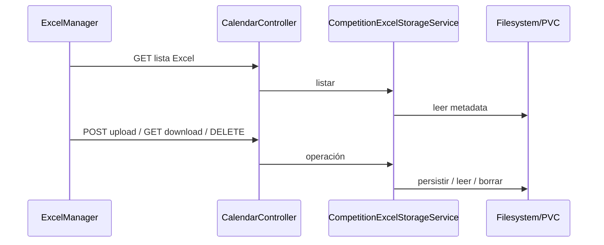
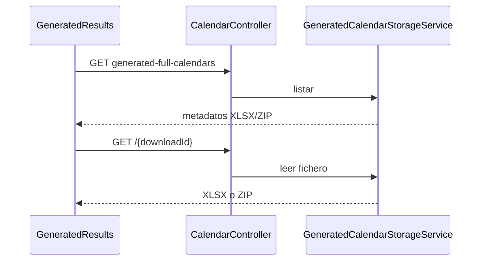
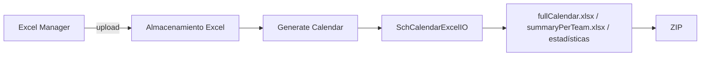
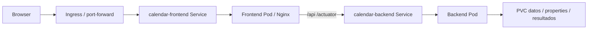

> **Base de evidencia utilizada en esta edición.** Auditoría de documentación de 03/09/2026, Word legacy inspeccionado de 9 páginas y evidencias de ejecución/código disponibles en la sesión. El enlace SharePoint proporcionado no pudo abrirse desde esta sesión; por tanto, su contenido complementario **no se ha utilizado**. Cuando falta evidencia se usa la frase obligatoria: **No se ha encontrado evidencia suficiente en el código fuente.**

# Objetivo del documento

Describir el uso, arquitectura, configuración, generación, almacenamiento, despliegue y mantenimiento de Calendar Morocco en su estado actual. El flujo principal es la aplicación web Angular; el procedimiento histórico de edición manual de properties y ejecución directa del algoritmo se conserva en la sección **Flujo legacy / ejecución manual**.

El alcance funcional preserva el objetivo histórico: generar de forma parcial por jornadas calendarios de D1, D2, F1 y F2, teniendo en cuenta restricciones y otras competiciones. El documento legacy confirma ese objetivo y el trabajo incremental por jornadas; la auditoría actual demuestra que el producto dispone ahora de frontend, API REST, almacenamiento de Excel, logs por generación y resultados descargables.

# Alcance

Incluye `CalendarGenerateBack`, `CalendarGenerateFront` y el repositorio Helm identificado como `CalendarGenerateHelmCharts`/`helmMorocco`. Se documentan el flujo web, API, motor legacy encapsulado, Excel, configuración, Docker/Nginx, Kubernetes/Helm, tests, logs y troubleshooting.

Quedan fuera los artefactos regenerables `node_modules/`, `target/`, `dist/`, `.angular/cache/` y `coverage/`. No se documenta base de datos porque no se encontró evidencia de que forme parte de esta aplicación. Tampoco se documenta autenticación/autorización como capacidad existente: No se ha encontrado evidencia suficiente en el código fuente.

# Visión general de Calendar Morocco

La aplicación actual permite seleccionar competición y temporada, gestionar el Excel de entrada, indicar la última jornada a asignar, lanzar la generación, consultar logs asociados a un `generationId` y descargar resultados XLSX/ZIP. El backend encapsula el algoritmo histórico mediante `ScheduleFacade` y servicios de aplicación.



# Repositorios y componentes

## Backend

Repositorio verificado por la auditoría: `git@github.com:ES-MEV-APPLICATIONS/CalendarGenerateBack.git`, rama observada `develop`. Aplicación Maven `net.atos.mev.calendarcalculator:calendarcalculator:0.0.1-SNAPSHOT`, Java 21, Spring Boot 3.5.16 según `pom.xml`, Apache POI 5.4.0 y puerto 8080.

Existe una inconsistencia: `HomeController.info()` devuelve texto fijo `Spring Boot 3.5.6`, mientras el POM declara 3.5.16. El POM debe prevalecer como fuente declarativa de versión.

## Frontend

Repositorio verificado por la auditoría: `git@github.com:ES-MEV-APPLICATIONS/CalendarGenerateFront.git`, rama observada `develop`. SPA Angular 21.x, componentes standalone y Signals. El `packageManager` declarado es `pnpm@10.29.3`. El proxy local reenvía `/api` y `/actuator` al backend en 8080. La auditoría observa Node 20 en CI y Node 22 en Docker; debe tratarse como discrepancia de toolchain pendiente de unificación.

## Helm/Kubernetes

Repositorio verificado por la auditoría: `git@github.com:ES-MEV-APPLICATIONS/CalendarGenerateHelmCharts.git`, rama observada `develop`. Charts: `helm/calendar-backend` y `helm/calendar-frontend`. Se encontraron Deployment, Service, ConfigMap, PVC para backend y Deployment, Service, ConfigMap Nginx e Ingress para frontend, con values `minikube`, `tst` y `pro`.

# Arquitectura del sistema



No se dibuja base de datos ni proveedor de identidad porque no se encontró evidencia suficiente para incluirlos.

# Arquitectura técnica

El frontend consume `/api` y `/actuator`. `CalendarController`, `CompetitionController`, `ConfigController` y `HomeController` son las entradas HTTP inventariadas. Los servicios principales son `CalendarGenerationService`, `CompetitionCatalogService`, `SeasonCatalogService`, `CompetitionPropertiesService`, `CompetitionExcelStorageService`, `GeneratedCalendarStorageService`, `GenerationLogStoreService` y `ScheduleFacade`.

El motor mantiene clases históricas como `ScheduleMoroccoAlg`, `LegacyCalendarEngine`, `SchEnvironment`, `SchCalendar`, `SchCalendarExcelIO`, `SchMatch`, `SchRound`, `Matchday` y `OtherCompetitionDay`.

**Evidencia:** `CalendarGenerationService.generateCalendar(...)` construye un directorio dinámico de resultados, crea `CompetitionRuntimeOverridesDTO`, carga properties finales, lee el Excel, invoca `scheduleFacade.run(...)` y crea el ZIP de generación.

# Flujo completo de generación



El flujo web principal demostrado es: selección de competición y temporada -> selección del Excel almacenado -> introducción de `Last Round To Assign` -> generación -> descarga del XLSX -> consulta de logs -> consulta/descarga de resultados generados.

# Guía funcional de la aplicación web

## Navegación general

Rutas principales:

| Ruta | Componente | Estado |
| --- | --- | --- |
| / | GenerateCalendar | Operativa |
| /excel-manager | ExcelManager | Operativa |
| /generated-results | GeneratedResults | Operativa |
| /results-manager | redirect | Compatibilidad |
| /properties | redirect | Editor no operativo como pantalla principal |
| * | redirect a / | Operativa |

## Generate Calendar

Controles demostrados por código/auditoría: `Competition`, `Refresh`, `Season`, `Excel File From Storage`, campo numérico `Last Round To Assign`, botón `Generate Calendar`, panel `Generation Logs` y botón `Refresh Logs`. El botón de generación permanece deshabilitado si faltan datos válidos. La validación observada exige un entero mayor que 0 para la última jornada.

La acción envía `POST /api/calendar/generate`, recibe un XLSX binario y conserva la cabecera `X-Generation-Id` para consultar logs.

> **Captura actual:** la auditoría confirma que fue revisada, pero la imagen no está disponible como fichero binario reutilizable en esta sesión. No se inserta una recreación para evitar inventar interfaz.

## Excel Manager

Permite seleccionar competición/temporada, refrescar, listar Excel con nombre/tamaño/fecha, descargar, borrar y subir `.xlsx`. Consume GET/POST/DELETE sobre el endpoint de Excel por competición y temporada.



> **Captura actual:** misma limitación de disponibilidad binaria indicada en Generate Calendar.

## Generated Results

Permite seleccionar competición/temporada, refrescar, agrupar por versión y descargar XLSX o ZIP. La auditoría observa tarjetas con nombre, tipo, carpeta, tamaño y fecha, además de `Download` y `Download ZIP`.



> **Captura actual:** misma limitación de disponibilidad binaria indicada en Generate Calendar.

## Logs de generación

`CalendarGenerationService.generateCalendarWithLogs(...)` abre una sesión en `GenerationLogStoreService`, adjunta un appender temporal al logger del paquete `net.atos.mev.calendarcalculator`, marca éxito o fallo y devuelve un `generationId`. El frontend consulta `/api/calendar/generations/{generationId}/logs`.

# Competiciones soportadas

| ID API | Nombre | Properties | Directorio | Environment |
| --- | --- | --- | --- | --- |
| BOTOLA_D1 | Botola Pro (1a Division) | schBotolaD1/SchMoroccoD1.properties | schBotolaD1 | MoroccoDiv1.properties |
| BOTOLA_D2 | Botola 2 (2a Division) | schBotolaD2/SchMoroccoD2.properties | schBotolaD2 | MoroccoDiv2v1.properties |
| CNPFF_D1 | CNPFF (1a Division Femenina) | schCNPFF1/MoroccoCNPFF1.properties | schCNPFF1 | MoroccoFemDiv1.properties |
| CNPFF_D2 | CNPFF (2a Division Femenina) | schCNPFF2/MoroccoCNPFF2.properties | schCNPFF2 | MoroccoFemDiv2.properties |

## BOTOLA_D1 / D1

Primera división masculina. El catálogo actual la identifica como `BOTOLA_D1` y usa `schBotolaD1/SchMoroccoD1.properties`.

## BOTOLA_D2 / D2

Segunda división masculina. El catálogo actual la identifica como `BOTOLA_D2` y usa `schBotolaD2/SchMoroccoD2.properties`.

## CNPFF_D1 / F1

Primera división femenina. El catálogo actual la identifica como `CNPFF_D1` y usa `schCNPFF1/MoroccoCNPFF1.properties`.

## CNPFF_D2 / F2

Segunda división femenina. El catálogo actual la identifica como `CNPFF_D2` y usa `schCNPFF2/MoroccoCNPFF2.properties`.

# Preparación del Excel

El conocimiento legacy válido indica que el trabajo es incremental: copiar el último Excel, incrementar la versión y verificar que las jornadas ya generadas están consolidadas. En la aplicación actual el Excel se administra desde **Excel Manager** y se selecciona desde **Generate Calendar**.

La convención validada explícitamente por backend para masculino es `CalendarD1-v<number>.xlsx` o `CalendarD2-v<number>.xlsx`, sin distinguir mayúsculas/minúsculas. Para femenino: No se ha encontrado evidencia suficiente en el código fuente.

La hoja principal observada es `Calendar`. Cabeceras reales observadas: `Competition`, `Round`, `Weekday`, `Date`, `Hour`, `Domicile`, `Exterieur`; en ejemplos también aparecen `real_date` y `weekday`.



# Configuración

La jerarquía documentada es: `application.yml` -> catálogo `calendar.competitions` -> properties por competición -> environment asociado -> overrides runtime -> filesystem/PVC.

Directorios configurados en `application.yml`: `calendar.config.competitions-dir=./data/competitions`, `calendar.storage.base-dir=./data/dataFiles`, `calendar.results.base-dir=./data/results`.

| Propiedad | Origen | Tipo | Valor/ejemplo observado | Descripción demostrada | Consumidor | Cuándo modificar | Riesgo |
| --- | --- | --- | --- | --- | --- | --- | --- |
| datesFile | properties de competición | String | ruta de Excel | Entrada legacy; en flujo web la selección del Excel se hace por parámetro y storage | motor / properties | Legacy o configuración base | Ruta incorrecta / fichero ausente |
| resultsFolder | properties + override runtime | String | results/<season>/<storageDir>-vN | Carpeta dinámica de resultados | CalendarGenerationService / motor | Normalmente resuelta por backend | Debe quedar bajo calendar.results.base-dir |
| ScheduleMoroccoAlg.lastRoundToAssign | properties + UI runtime | Integer | 5 (ejemplo observado) | Última jornada a asignar | CalendarGenerationService / algoritmo | Usuario en Generate Calendar | Valor inválido o incoherente |
| ScheduleMoroccoAlg.competitions | properties | CSV | F1,F2,D1,D2,CT,CL,CC,ASC,UAFA,CHAN,CLHOME,CCHOME,FIFA,AC | Lista de códigos considerados por algoritmo | ScheduleMoroccoAlg | Configuración de temporada | No traducir siglas sin evidencia |
| ScheduleMoroccoAlg.timeslots | properties | CSV horas | 15:00,15:00,15:00,15:00 | Franjas normales observadas | algoritmo de timing | Configuración de temporada | Puede afectar capacidad diaria |
| ScheduleMoroccoAlg.ramadan.timeslots | properties | CSV horas | 22:00 | Franja Ramadan observada | algoritmo de timing | Configuración de temporada | Validar fechas Ramadan |
| ScheduleMoroccoAlg.timeslotWithoutLight | properties | hora | 15:00 | Franja específica observada | algoritmo de timing | Configuración de temporada | Afecta equipos listados |
| ScheduleMoroccoAlg.teamsWithoutLight | properties | CSV equipos | lista dependiente de temporada | Equipos afectados por franja sin iluminación | algoritmo de timing | Configuración de temporada | No reutilizar lista entre temporadas sin revisar |

`CompetitionPropertiesServiceTest` demuestra inicialización/copia de properties al filesystem y carga desde directorio de datos. La documentación actual no debe presentar `SchEnvironment.properties` como único punto de configuración.

# Generación Primera División

Flujo actual: seleccionar `BOTOLA_D1` o `CNPFF_D1`, temporada, Excel almacenado y `Last Round To Assign`; generar; revisar logs y descargar resultados. El conocimiento legacy sobre preparación incremental del Excel sigue siendo útil como disciplina operativa.

# Generación Segunda División

El Word legacy indica que, antes de generar F2/D2, el Excel de segunda división incorpora partidos ya calculados de primera división para tenerlos en cuenta. La auditoría actual demuestra que `SchCalendarExcelIOTest` preserva filas de otras competiciones al reescribir. La dependencia operativa primera->segunda se conserva como conocimiento válido, pero cualquier automatización específica de esa copia debe verificarse en código antes de asumirla.

# Competiciones externas

El Word legacy y los Excel inspeccionados contienen códigos de competiciones externas y filas que condicionan el calendario. Se observaron `FIFA`, `WC`, `CHAN`, `CLHOME`, `CCHOME`, `ASC`, `CC` y, en properties, además `CT`, `CL`, `UAFA`, `AC`.

No se asigna significado oficial a cada sigla salvo D1/D2/F1/F2. Para el resto: No se ha encontrado evidencia suficiente en el código fuente.

La auditoría demuestra restricciones de descanso entre competiciones y preservación de filas de otras competiciones.

# Restricciones y reglas

Checks encontrados: `DerbyTeamsCheck`, `PlayTogetherTeamsCheck`, `ForcePositionsCheck`, `HalfMatchesAtHomeCheck`, `LimitAgainstTeamsInRoundsCheck`, `LimitAgainstTeamsInRoundsHomeCheck`, `LimitHomeTogetherCheck`, `MatchNotInRoundCheck`, `NotConsecutiveFarAwayCheck`, `SeparateMatchesCheck`.

La auditoría demuestra lógica relacionada con derbis, equipos que juegan juntos, localías, separación de partidos, descanso entre competiciones, aplazamientos/MAJ y asignación por días/horas. La clasificación exacta entre restricciones duras/blandas y la fórmula de coste de cada check: No se ha encontrado evidencia suficiente en el código fuente.

# Ramadán y horarios especiales

Se observaron propiedades `ScheduleMoroccoAlg.ramadan.start`, `ScheduleMoroccoAlg.ramadan.end` y `ScheduleMoroccoAlg.ramadan.timeslots`. Los valores dependen de temporada. También existen `ScheduleMoroccoAlg.timeslotWithoutLight` y `ScheduleMoroccoAlg.teamsWithoutLight`.

La semántica general de horario especial de Ramadán y franja para equipos sin iluminación está demostrada por auditoría; la fórmula exacta de selección de hora: No se ha encontrado evidencia suficiente en el código fuente.

# Algoritmo ScheduleMoroccoAlg

El punto de entrada web no ejecuta directamente la clase desde el IDE: pasa por `ScheduleFacade`. `SchEnvironment.loadEnvironment(...)` carga properties, equipos y checks; su resolución busca ruta absoluta, ruta indicada, `./data/dataFiles`, `./data`, `/config/competitions` y finalmente classpath, y lanza error si no encuentra el fichero.

`CalendarGenerationService.generateCalendar(...)` crea overrides runtime para `resultsFolder` y `lastRoundToAssign`, carga properties finales, lee el Excel y llama a `ScheduleFacade.run(finalProperties, inputStream)`.

La auditoría demuestra generación parcial, restricciones de descanso, Ramadán, iluminación, externos, aplazamientos, asignación por fechas y horas y producción de estadísticas. La explicación método-a-método de cálculo de coste se desarrolla en `docs/algoritmo-schedule-morocco.md` con las limitaciones de evidencia disponibles.

# Excel de entrada

Librería: Apache POI 5.4.0. Clase central: `SchCalendarExcelIO`. Hoja observada: `Calendar`.

`SchCalendarExcelIOTest` demuestra tres propiedades críticas: preservación de filas completas de otras competiciones, preservación de filas de plantilla posteriores y preservación de estilos de celda al reescribir. Esto justifica mantener información consolidada y externa en el Excel de entrada.

# Excel de salida

Resultados demostrados: `fullCalendar.xlsx`, `summaryPerTeam.xlsx`, estadísticas CSV/XLSX y ZIP. `GeneratedCalendarStorageServiceTest` demuestra que los `out*.csv` se excluyen del ZIP de generación.

# API REST

| Método | Endpoint | Controller / método | Request | Response | Códigos HTTP | Consumidor |
| --- | --- | --- | --- | --- | --- | --- |
| GET | /api/calendar/competitions/{competitionId}/seasons/{season}/excels | CalendarController.listExcelFiles | path competitionId, season | Lista CompetitionExcelFileDTO | No se ha encontrado evidencia suficiente en el código fuente. | Generate Calendar / Excel Manager |
| POST | /api/calendar/competitions/{competitionId}/seasons/{season}/excels | CalendarController.uploadExcelFile | multipart excel; overwrite opcional | CompetitionExcelFileDTO | No se ha encontrado evidencia suficiente en el código fuente. | Excel Manager |
| DELETE | /api/calendar/competitions/{competitionId}/seasons/{season}/excels/{fileName} | CalendarController.deleteExcelFile | path | sin cuerpo | 204 o error | Excel Manager |
| GET | /api/calendar/competitions/{competitionId}/seasons/{season}/excels/{fileName} | CalendarController.downloadExcelFile | path | XLSX binario | No se ha encontrado evidencia suficiente en el código fuente. | Excel Manager |
| POST | /api/calendar/generate | CalendarController.generateCalendar | competitionId, season, excelFileName, lastRoundToAssign | XLSX binario + X-Generation-Id | No se ha encontrado evidencia suficiente en el código fuente. | Generate Calendar |
| GET | /api/calendar/generations/{generationId}/logs | CalendarController (logs) | path generationId | GenerationLogsDTO | No se ha encontrado evidencia suficiente en el código fuente. | Generation Logs |
| GET | /api/calendar/competitions/{competitionId}/seasons/{season}/generated-full-calendars | CalendarController.listGeneratedFullCalendars | path | Lista GeneratedCalendarFileDTO | No se ha encontrado evidencia suficiente en el código fuente. | Generated Results |
| GET | /api/calendar/competitions/{competitionId}/seasons/{season}/generated-full-calendars/{downloadId} | CalendarController.downloadGeneratedFullCalendar | path | XLSX o ZIP | No se ha encontrado evidencia suficiente en el código fuente. | Generated Results |
| GET | /api/config/competitions | CompetitionController.competitions | - | Lista CompetitionDTO | No se ha encontrado evidencia suficiente en el código fuente. | Selects de competición |
| GET | /api/config/competitions/{id} | CompetitionController.competitionById | path id | CompetitionDTO | No se ha encontrado evidencia suficiente en el código fuente. | Soporte catálogo |
| GET | /api/config/seasons | CompetitionController.seasons | - | Lista SeasonDTO | No se ha encontrado evidencia suficiente en el código fuente. | Selects de temporada |
| POST | /api/config/competitions/{id}/resolve | CompetitionController.resolveCompetitionProperties | CompetitionRuntimeOverridesDTO | Mapa de properties resueltas | No se ha encontrado evidencia suficiente en el código fuente. | Uso visible principal no confirmado |
| GET | /api/config/options | ConfigController.getOptions | - | Mapa configOptions | No se ha encontrado evidencia suficiente en el código fuente. | Servicio config; editor no operativo |
| GET | / | HomeController.home | - | Texto | No se ha encontrado evidencia suficiente en el código fuente. | Diagnóstico |
| GET | /health | HomeController.health | - | Texto | No se ha encontrado evidencia suficiente en el código fuente. | Diagnóstico |
| GET | /info | HomeController.info | - | Texto | No se ha encontrado evidencia suficiente en el código fuente. | Diagnóstico |
| GET | /actuator/health | Actuator | - | JSON Actuator | 200 cuando healthy (comportamiento estándar; confirmar en entorno) | BackendStatus / infraestructura |

No se encontraron `@PutMapping` ni `@PatchMapping` en los controladores inventariados. Para `@ExceptionHandler`: No se ha encontrado evidencia suficiente en el código fuente.

# Frontend Angular

Angular 21.x, componentes standalone y Signals. `pnpm@10.29.3`. Rutas operativas: `/`, `/excel-manager`, `/generated-results`. `/properties` y `/results-manager` redirigen según el routing inventariado. `PropertiesEditor`, `PropertiesManager` y `ResultsManager` no deben presentarse como pantallas principales operativas.

El frontend local usa proxy para `/api` y `/actuator` hacia backend 8080. El usuario ha ejecutado `pnpm start`, que lanza `ng serve --proxy-config proxy.local.json`; el puerto por defecto observado es 4200.

# Backend Spring Boot

Spring Boot 3.5.16 según POM, Java 21, Apache POI 5.4.0, MVC, Actuator y tests. Puerto 8080. La suite backend observada compila 80 fuentes y 8 fuentes de test con Java 21.

Controllers: `CalendarController`, `CompetitionController`, `ConfigController`, `HomeController`.

Servicios principales: `CalendarGenerationService`, `CompetitionCatalogService`, `SeasonCatalogService`, `CompetitionPropertiesService`, `CompetitionExcelStorageService`, `GeneratedCalendarStorageService`, `GenerationLogStoreService`, `ScheduleFacade`.

# Ejecución local

## Backend

Comandos demostrados de build/test:

```bash
cd ~/mev/git/morocco/CalendarGenerateBack
clear
mvn clean test
mvn clean package
```

Ejecución de JAR demostrada en sesión:

```bash
cd ~/mev/git/morocco/CalendarGenerateBack
clear
java -jar target/calendarcalculator-0.0.1-SNAPSHOT.jar
```

También existe configuración VS Code con `mainClass=net.atos.mev.calendarcalculator.CalendarcalculatorApplication` y Java 21.

## Frontend

El frontend no forma parte de este repositorio backend: los comandos `pnpm` se ejecutan desde el repo del front (`CalendarGenerateFrontNew`).

```bash
cd ~/morocco/CalendarGenerateFrontNew
clear
pnpm install
pnpm start
```

`pnpm start` ejecuta `ng serve --proxy-config proxy.local.json`; URL local habitual `http://localhost:4200`.

Versión exacta de Maven Wrapper: No se ha encontrado evidencia suficiente en el código fuente.

# Docker

Backend: Dockerfile multistage con imagen de build Maven/Temurin 21 y runtime `eclipse-temurin:21-jre`; puerto 8080. Frontend: build Angular y Nginx 1.27. Nginx sirve la SPA, hace fallback al `index.html` y proxifica `/api` y `/actuator` a `calendar-backend:8080`. Límite de subida observado: 50 MB.

Imágenes CI observadas: `ghcr.io/es-mev-applications/calendar/calendar-backend` y `ghcr.io/es-mev-applications/calendar/calendar-frontend`.

# Kubernetes / Minikube / Helm



Charts: `helm/calendar-backend`, `helm/calendar-frontend`. Services: `calendar-backend` y `calendar-frontend`. Se observó `port-forward-frontend.sh` con 8888:80 en la auditoría.

Existe una discrepancia de evidencia para TST: la auditoría del ZIP recoge defaults más genéricos, mientras evidencias operativas posteriores muestran scripts con contexto `mth-k2akscv-001` y namespace `mth-frmf-tst`, y documentación previa con referencias WPD. Antes de publicar un procedimiento TST único hay que reconciliar la rama/commit de Helm. Por tanto, para nombres definitivos de contexto/namespace TST: No se ha encontrado evidencia suficiente en el código fuente.

Comandos de diagnóstico genéricos válidos una vez conocidos `<contexto>` y `<namespace>`:

```bash
kubectl --context <contexto> -n <namespace> get pods
kubectl --context <contexto> -n <namespace> get svc
kubectl --context <contexto> -n <namespace> get ingress
kubectl --context <contexto> -n <namespace> get endpointslices
kubectl --context <contexto> -n <namespace> describe pod <pod>
kubectl --context <contexto> -n <namespace> logs <pod> --tail=200
```

# Tests

## TEST EXISTENTE

| Test | Tipo | Qué valida según auditoría |
| --- | --- | --- |
| CalendarcalculatorApplicationTests | Spring context | Carga del contexto |
| CalendarControllerTest | Controller | Listado/upload/validación/borrado/download/generación/logs/resultados XLSX/ZIP |
| CompetitionControllerTest | Controller | Catálogo y resolución de overrides |
| SchCalendarExcelIOTest | Excel / POI | Preservación de otras competiciones, filas posteriores y estilos |
| GeneratedCalendarStorageServiceTest | Servicio storage | ZIP, exclusiones y preferencia de carpetas versionadas |
| CompetitionPropertiesServiceTest | Servicio properties | Base, overrides, seeding, filesystem y error de properties ausente |
| CompetitionExcelStorageServiceTest | Servicio storage | Seeding, listado, lectura, temporales, borrado, patrón de nombres, resultados y no sobrescritura |
| CalendarGenerationServiceTest | Servicio | Orquestación y carpeta dinámica de resultados |
| app.spec.ts | Frontend | Spec base; cobertura específica de pantallas no demostrada |

## TEST RECOMENDADO

No se encontraron tests específicos suficientes para componentes Angular principales, integración frontend-backend, reglas deterministas D1/D2/F1/F2, Ramadán, iluminación, externos, aplazamientos, restricciones imposibles ni smoke tests Helm completos. Deben tratarse como recomendaciones, no como tests existentes.

# Logs y monitorización

El backend expone Actuator y `/actuator/health`. La generación mantiene logs en memoria asociados a `generationId` mediante `GenerationLogStoreService` y un appender temporal. Los niveles de log observados en `application.yml` incluyen web `INFO`, paquetes MEV `DEBUG` y schedules `TRACE`.

Persistencia de auditoría de logs fuera del proceso: No se ha encontrado evidencia suficiente en el código fuente.

# Troubleshooting

| Síntoma | Causas demostrables | Cómo comprobarlo | Solución basada en evidencia |
|---|---|---|---|
| Frontend no arranca | puerto 4200 ocupado | `lsof -i :4200` | liberar el proceso o aceptar otro puerto |
| Frontend no conecta | proxy/backend no disponible | revisar 4200, 8080 y `/actuator/health` | arrancar backend y usar `proxy.local.json` del repo `CalendarGenerateFrontNew` |
| Excel inválido | nombre/patrón o archivo ausente | respuesta del endpoint / logs | usar Excel válido almacenado para competición/temporada |
| Properties ausente | no resuelta en filesystem/classpath | logs de `CompetitionPropertiesService` / `SchEnvironment` | verificar catálogo y rutas de datos |
| Generación 500 | error raíz capturado por `GenerationFailedException` | consultar logs por `generationId` | corregir causa y repetir |
| Resultado no generado | fallo de algoritmo o storage | logs + carpeta `data/results` | revisar `lastRoundToAssign`, Excel y properties |
| CrashLoopBackOff | pod backend/frontend no arranca | `kubectl describe` + `kubectl logs` | corregir imagen/config/mount según mensaje |
| Service sin endpoints | selector/pods no coinciden | `kubectl get endpointslices` | revisar labels/selectors y estado de pods |
| PVC no montado | claim/mount incorrecto | `kubectl describe pod` / `kubectl get pvc` | corregir values/template |
| pull GHCR fallido | credenciales/imagePullSecret | eventos del pod | revisar secret y referencia de imagen |
| port-forward caído | proceso terminado o Service no disponible | terminal de port-forward | relanzar script/comando |

Para causas no demostradas en código, aplicar la frase obligatoria: No se ha encontrado evidencia suficiente en el código fuente.

# Checklist operativo

Flujo web recomendado: confirmar competición y temporada; confirmar Excel disponible; introducir última jornada; lanzar generación; revisar descarga XLSX; revisar logs; revisar Generated Results y ZIP; validar calendario antes de entrega.

El checklist legacy conserva además: incrementar versión de Excel/resultados, actualizar competiciones externas y, para segunda división, verificar que el Excel contiene la información consolidada de primera división requerida por el proceso.

# Entrega del calendario

El Word legacy indica preparar los Excel finales y entregar el calendario validado al cliente. El sistema actual añade la posibilidad de descargar el XLSX de generación y los resultados almacenados/ZIP desde la interfaz.

Mecanismo de distribución externo al usuario final: No se ha encontrado evidencia suficiente en el código fuente.

# Mantenimiento y desarrollo

Backend: Java 21, Spring Boot según POM, tests Maven. Frontend: Angular 21.x y pnpm 10.29.3. Helm: repositorio separado. Debe mantenerse sincronizada la documentación con POM/package/lock/Docker/CI y evitar textos de versión hardcodeados como el de `HomeController.info()`.

Antes de cambios en algoritmo, añadir tests focalizados. Antes de cambios de Helm, renderizar templates y ejecutar `helm lint`/smoke tests en entorno seguro cuando estén disponibles.

# Flujo legacy / ejecución manual

Esta sección conserva el procedimiento histórico del Word original, pero ya no se presenta como modo principal.

1. Preparar el Excel de entrada copiando el último generado, incrementando versión y consolidando jornadas anteriores.
2. Seleccionar una única competición mediante `SchEnvironment.properties` (D1, D2, CNPFF1/F1, CNPFF2/F2).
3. Editar properties de competición: `datesFile`, `resultsFolder`, `ScheduleMoroccoAlg.lastRoundToAssign`.
4. Configurar/actualizar competiciones externas y restricciones de temporada.
5. Ejecutar manualmente `ScheduleMoroccoAlg` desde el entorno de desarrollo.
6. Revisar resultados y conflictos.
7. Si una restricción impide asignación, el manual permite ajustar manualmente el Excel y repetir.
8. Validar primera división antes de preparar segunda; el Excel de F2/D2 incorpora información consolidada de F1/D1 según el manual.
9. Aplicar horarios de Ramadán y de equipos sin iluminación según properties.
10. Preparar Excel final para entrega.

Correcciones aplicadas sobre nomenclatura: `ScheduleMorocoAlg` -> `ScheduleMoroccoAlg`; `properies` -> `properties`; `rchivo` -> `archivo`. Se han eliminado repeticiones y numeración rota del texto, preservando el conocimiento funcional.

> Las capturas legacy del Word original fueron inspeccionadas (arquitectura simple, `SchEnvironment.properties`, properties, ejemplos Excel y árbol Java), pero no están disponibles como binarios reutilizables en la sesión de generación. No se sustituyen por imágenes inventadas.

# Referencias GitHub

- Backend: `git@github.com:ES-MEV-APPLICATIONS/CalendarGenerateBack.git`
- Frontend: `git@github.com:ES-MEV-APPLICATIONS/CalendarGenerateFront.git`
- Helm: `git@github.com:ES-MEV-APPLICATIONS/CalendarGenerateHelmCharts.git`
- Helm legacy histórico observado: `git@github.com:JmTortolero/ChartsMorocco.git`

# Matriz de trazabilidad

La matriz detallada se entrega en `docs/matriz-trazabilidad-calendar.md`. Resumen:

| Afirmación | Evidencia principal | Estado |
| --- | --- | --- |
| Flujo principal web Angular -> API -> motor | Auditoría secciones 1, 4, 5, 6 | Demostrado |
| Spring Boot 3.5.16 / Java 21 / POI 5.4.0 | pom.xml según auditoría + ejecución Java 21 | Demostrado |
| Tres pantallas operativas | routing/componentes/capturas revisadas en auditoría | Demostrado |
| Preservación de otras competiciones y estilos | SchCalendarExcelIOTest | Demostrado |
| ZIP excluye out*.csv | GeneratedCalendarStorageServiceTest | Demostrado |
| Flujo manual SchEnvironment.properties | Word legacy | Legacy |
| Autenticación/autorización | Sin evidencia | No encontrado |
| Contexto/namespace TST definitivo | Evidencia contradictoria entre auditoría y logs posteriores | Pendiente de validación |
| Contenido complementario SharePoint | Enlace no accesible en sesión | Pendiente de validación |

## Resumen de cierre

**ACTUALIZADO:** flujo web como principal, arquitectura, API, pantallas, configuración por capas, storage, Excel, Docker/Nginx, Helm, tests, logs y troubleshooting.

**CONSERVADO COMO LEGACY:** preparación incremental del Excel, selección manual de competición, edición directa de properties, ejecución directa del algoritmo, ajustes manuales y dependencia operativa primera/segunda división.

**NO ENCONTRADO:** autenticación/autorización, base de datos, auditoría persistente externa, tests frontend específicos suficientes y varias pruebas deterministas del algoritmo.

**PENDIENTE DE VALIDACIÓN:** contenido SharePoint, versión Maven Wrapper, toolchain Node única y parámetros definitivos de TST/PRO que presentan evidencia divergente.

**RIESGOS:** documentación de siglas externas sin significado demostrado, valores de temporada reutilizados fuera de contexto, considerar componentes placeholder como operativos y publicar comandos TST sin reconciliar el commit real de Helm.
