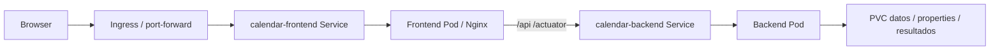

# Runbook Calendar Morocco

## Desarrollo local

### Backend
```bash
cd ~/mev/git/morocco/CalendarGenerateBack
clear
mvn clean test
mvn clean package
java -jar target/calendarcalculator-0.0.1-SNAPSHOT.jar
```
Puerto configurado: `8080`. Java: 21. Versión Maven Wrapper exacta: No se ha encontrado evidencia suficiente en el código fuente.

### Frontend
El frontend no forma parte de este repositorio backend: los comandos `pnpm` se ejecutan desde el repo del front (`CalendarGenerateFrontNew`).

```bash
cd ~/morocco/CalendarGenerateFrontNew
clear
pnpm install
pnpm start
```
`pnpm start` ejecuta `ng serve --proxy-config proxy.local.json`. Puerto por defecto observado: `4200`. Si está ocupado: `lsof -i :4200` y detener el PID antes de arrancar.

### Health
```bash
curl http://localhost:8080/actuator/health
```

## Docker
Backend Java 21, frontend Nginx 1.27. Nginx proxifica `/api` y `/actuator` a `calendar-backend:8080` y limita upload a 50 MB.

## Kubernetes / Helm



Charts: `helm/calendar-backend`, `helm/calendar-frontend`. Services: `calendar-backend`, `calendar-frontend`. Values: `minikube`, `tst`, `pro`.

Para TST existe evidencia divergente sobre contexto/namespace entre auditoría y sesiones posteriores. No publicar una única combinación sin verificar el commit Helm que se va a desplegar.

```bash
kubectl --context <contexto> -n <namespace> get pods
kubectl --context <contexto> -n <namespace> get svc
kubectl --context <contexto> -n <namespace> get ingress
kubectl --context <contexto> -n <namespace> get endpointslices
kubectl --context <contexto> -n <namespace> describe pod <pod>
kubectl --context <contexto> -n <namespace> logs <pod> --tail=200
```

## Troubleshooting

### Frontend: port 4200 in use
Síntoma: Angular pregunta por otro puerto.

Comprobación:
```bash
lsof -i :4200
```
Solución: detener el PID y relanzar `pnpm start` desde `CalendarGenerateFrontNew`.

### Backend no arranca
Comprobar Java 21, puerto 8080, logs y `application.yml`. Para causa concreta: No se ha encontrado evidencia suficiente en el código fuente.

### Frontend no conecta con backend
Comprobar `proxy.local.json` (en `CalendarGenerateFrontNew`), backend 8080 y `/actuator/health`.

### Excel inválido / ausente
Comprobar competición, temporada, nombre y listado del endpoint de Excel. La validación masculina acepta `CalendarD1-vN.xlsx` y `CalendarD2-vN.xlsx`. Para femenino: No se ha encontrado evidencia suficiente en el código fuente.

### Properties ausente
`CompetitionPropertiesService` y `SchEnvironment` buscan filesystem y classpath. Revisar rutas configuradas y logs.

### Error de generación
Usar `X-Generation-Id`/panel Generation Logs; `CalendarGenerationService` registra error raíz y marca la sesión como failure.

### K8s CrashLoopBackOff
`kubectl describe pod` + `kubectl logs`. Revisar imagen, configuración y PVC.

### Service sin endpoints
`kubectl get endpointslices`; revisar selectors/labels y readiness.

### Pull GHCR fallido
Revisar eventos del pod, nombre de imagen y `imagePullSecrets`. Detalles exactos del secret: No se ha encontrado evidencia suficiente en el código fuente.

### PVC no montado
`kubectl get pvc` + `kubectl describe pod`. Revisar values/template backend.
